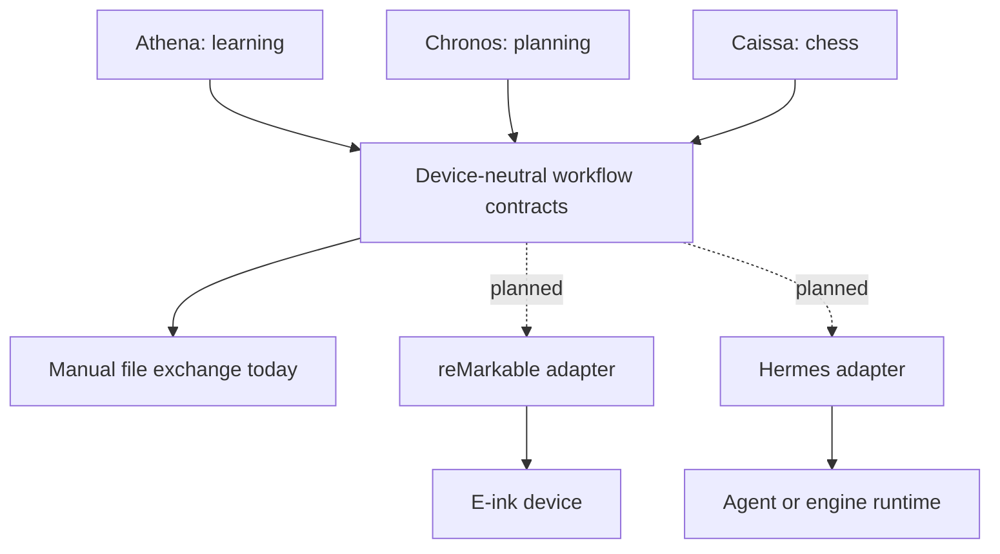

# E-Ink Agent Suite

Small, honest experiments for using an e-ink tablet as a calm interface for learning, planning, and chess.

This release candidate contains two working, dependency-free browser prototypes, one synthetic planner artifact, and an experimental reMarkable AppLoad interaction. It does **not** contain a finished product, a live-device installer, a Hermes integration, or any private user data.

This verified meetup release is published at [`Silkreactor/eink-agent-suite`](https://github.com/Silkreactor/eink-agent-suite). Its public URL and repository contents were checked before QR generation.

## What works today

| Module | Implemented and locally verified | Demo or experiment | Planned, not implemented |
|---|---|---|---|
| **Athena** | A local browser tool turns a 100–300 word note into exactly three retrieval questions and one reflection prompt; automated tests cover deterministic generation and validation. | A synthetic one-page PDF worksheet. | AI-assisted generation, saved learning records, handwriting recognition, and device transfer. |
| **Chronos** | A synthetic one-page weekly agenda has been rendered and checked for text, color/grayscale distinction, and page geometry. | PDF and PNG preview. | A public renderer, calendar import, task sync, handwriting extraction, and regeneration. |
| **Caissa** | A local browser chess prototype supports legal play, special moves, two-player mode, five clearly labelled test opponents, and eight automated checks. | A frontend-only AppLoad experiment implements the first `e2`–`e4` interaction; it is not the full chess app. | Production chess engine, calibrated levels, Hermes adapter, persistence, and full AppLoad packaging. |
| **Shared architecture** | Privacy and adapter boundaries are documented. | — | Reusable core packages and production reMarkable/Hermes adapters. |

Physical-device acceptance is still pending. “Locally verified” means desktop/browser or generated-artifact checks only.

## Quick start

No install is required for the browser prototypes.

### Athena

1. Open `apps/athena/index.html` in a modern browser.
2. Load the invented example or enter a non-sensitive note of 100–300 words.
3. Generate the worksheet, then use the browser’s print preview to save a one-page PDF.

Run its checks with Node.js 18 or newer:

```sh
node --test apps/athena/tests/question-engine.test.js
```

### Chronos

Open `apps/chronos/demo/chronos-weekly-agenda-mock.pdf` or its PNG preview. The repository currently provides the synthetic artifact, not the renderer that produced it.

### Caissa

1. Open `apps/caissa/index.html` directly in a modern browser.
2. Choose two-player or computer mode.
3. Treat the five computer levels as interaction-test profiles, not chess ratings or a production engine.

Run its checks with Node.js 18 or newer:

```sh
node --test apps/caissa/tests/chess.test.js
```

An optional loopback-only preview server is also available:

```sh
node apps/caissa/scripts/serve.js
```

## Architecture



The core workflows must remain useful without reMarkable or Hermes. Adapters may automate delivery or agent calls later, but private configuration never belongs in the core records. See [Architecture](docs/ARCHITECTURE.md).

## Privacy and security

This candidate uses invented examples only. It deliberately excludes:

- credentials, tokens, environment files, SSH material, device identifiers, network coordinates, and provider configuration;
- real notes, calendars, handwriting, game history, personal profiles, logs, and generated personal PDFs;
- private Hermes runtime configuration, prompts, transcripts, and operational data;
- device recovery, maintenance, deployment, and network-watchdog material.

Do not add real personal data to fixtures or screenshots. Keep runtime data outside the repository and avoid logging note text, calendar content, handwriting, tokens, addresses, or device identifiers. See [Security](SECURITY.md).

## Roadmap

The next useful public steps are intentionally small:

1. Reproduce all checks in GitHub Actions after the public repository exists.
2. Publish the Chronos renderer or clearly keep Chronos as a design/demo slice.
3. Define device-neutral request/result contracts shared by at least two modules.
4. Turn the Caissa AppLoad experiment into a reproducible, sandboxed demo package.
5. Add reMarkable and Hermes adapters only after their configuration and logging boundaries have dedicated tests.

See [Contributing](CONTRIBUTING.md) for the evidence required when changing a status claim.

## Project status and naming

E-Ink Agent Suite, Athena, Chronos, and Caissa are working names. reMarkable is a trademark of its owner; this project is independent and is not endorsed by or affiliated with reMarkable AS. Hermes is treated here as an adapter boundary, not as a bundled runtime.

## License

Licensed under the [Apache License 2.0](LICENSE), a permissive license with an explicit patent grant. Its tradeoff compared with MIT is a longer notice and compliance burden.
