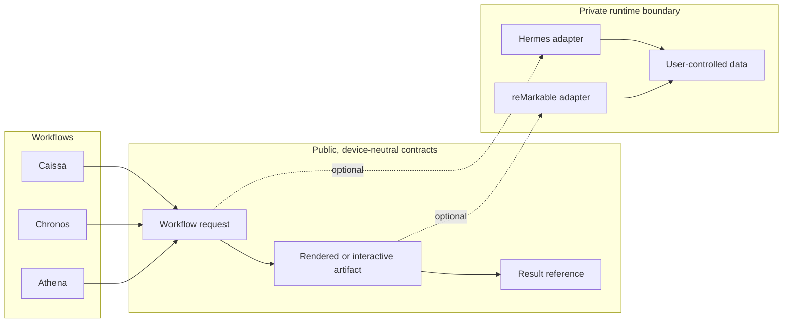

# Architecture and trust boundaries

The suite is organized around device-neutral workflows. reMarkable and Hermes are initial adapters, not dependencies of the domain logic.

## Current implementation map

| Boundary | Current state |
|---|---|
| Athena note-to-worksheet logic | Implemented in a dependency-free browser prototype. |
| Chronos week model and renderer | Design documented elsewhere; only a synthetic rendered artifact is in this candidate. |
| Caissa rules and local interaction | Implemented in a dependency-free browser prototype. |
| Caissa AppLoad UI | Experimental first-move frontend only. |
| Shared workflow package | Planned. |
| reMarkable adapter | Planned; no public device access, deployment, sync, or maintenance code is included. |
| Hermes adapter | Planned interface boundary only; no runtime configuration, provider setup, credentials, or client code is included. |

## Proposed public contracts

These are design targets, not stable APIs.

### Workflow request

- a schema version;
- non-sensitive user input or a private-runtime reference to it;
- a workflow kind and options;
- a non-identifying request ID.

### Artifact

- a media type and page/viewport profile;
- content generated by the workflow;
- provenance sufficient to reproduce a synthetic fixture;
- no embedded credential or network coordinate.

### Result reference

- status and timestamps;
- a user-controlled path or opaque reference to the returned artifact;
- validation facts, not copied personal content;
- an explicit retention/deletion policy when persistence is added.

## Non-goals for the current candidate

- universal e-ink compatibility;
- automatic device discovery or installation;
- remote device maintenance;
- bundled agent/provider configuration;
- cloud accounts, telemetry, or personal-data sync;
- production chess strength or calibrated ratings.

